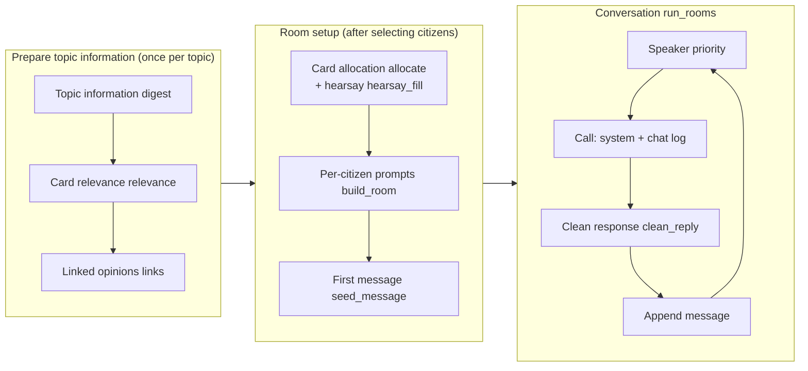

**English** | [한국어](README.md)

<div align="center">


# 사랑방 sarangbang

**Korean group-chat public-opinion simulation engine**

Simulates virtual citizens talking about a topic such as a policy, a product, or neighborhood news.<br>
From the chat log you can examine each citizen's concerns, the main issues, and where opinions differ.

[](https://pypi.org/project/sarangbang/)
[](pyproject.toml)
[](LICENSE)
[](https://github.com/SpringWindsTeam/sarangbang/actions/workflows/ci.yml)
[](https://huggingface.co/datasets/springwindteam/nemotron-personas-korea-augmented)


[Install](#install) · [Try it in 30 seconds](#try-it-in-30-seconds) · [Korean AI](#connecting-korean-ai-models) · [Core concepts](#core-concepts) · [Scenario files](#scenario-files) · [Command-line tool](#command-line-tool)


<sub>A group chat simulated with sarangbang — seven virtual viewers react to a dating show (model: A.X-K2)</sub>

</div>

---

You can run a simulation without assigning pro or con positions in advance; it works from each citizen's background, concerns, and the conversation context.
If needed, you can also assign each citizen a pro/con leaning computed outside the engine.

sarangbang was developed for Korean-language simulations using LG AI Research's [EXAONE](https://huggingface.co/LGAI-EXAONE) and SK Telecom's [A.X (A-dot X)](https://huggingface.co/skt).
While testing with these two models, we tuned the prompts and post-processing to reduce repeated messages, unsupported content, and malformed responses.
Since 0.2, you can **switch with a single preset** between Korean APIs such as Upstage Solar and NAVER HyperCLOVA X, gateway platforms such as FriendliAI and OpenRouter,
and open-weight models you serve yourself with vLLM or Ollama (K-EXAONE, A.X K2, Solar Open, HyperCLOVA X SEED, Kanana, Mi:dm (믿:음) …).

You can use the [Nemotron-Personas-Korea augmented dataset](https://huggingface.co/datasets/springwindteam/nemotron-personas-korea-augmented), also released by Team Chunpung, as citizen data. It contains profiles of 1 million synthetic Korean people and is provided under the CC BY 4.0 license.

## Table of contents

- [Install](#install)
- [Try it in 30 seconds](#try-it-in-30-seconds)
- [Connecting Korean AI models](#connecting-korean-ai-models)
- [Design background](#design-background)
- [Features](#features)
- [How it works](#how-it-works)
- [Core concepts](#core-concepts)
- [Scenario files](#scenario-files)
- [Building a knowledge base and runnable examples](#building-a-knowledge-base-and-runnable-examples)
- [Command-line tool](#command-line-tool)
- [Prompt spec JSON](#prompt-spec-json)
- [Topic settings (Topic)](#topic-settings-topic)
- [Adding to the prompt (PromptPlugin)](#adding-to-the-prompt-promptplugin)
- [Writing a persona adapter](#writing-a-persona-adapter)
- [Preparing topic information and issue cards](#preparing-topic-information-and-issue-cards)
- [Result format](#result-format)
- [Model backends](#model-backends)
- [Settings tuned for EXAONE and A.X](#settings-tuned-for-exaone-and-ax)
- [FAQ](#faq)
- [Repository layout](#repository-layout)
- [Contributing](#contributing)
- [Citation](#citation)
- [License](#license)

## Install

```bash
pip install sarangbang                       # Python 3.10+, the only runtime dependency is httpx
```

```bash
pip install git+https://github.com/SpringWindsTeam/sarangbang.git     # latest main
git clone https://github.com/SpringWindsTeam/sarangbang.git && cd sarangbang && pip install -e ".[dev]"   # development
```

## Try it in 30 seconds

```bash
sarangbang quickstart --fake --msgs 10
```

```text
#  1 07:00 마포: 다음 달부터 구립 도서관이 밤 10시까지 연다네요~^^ 퇴근하고 갈 수 있겠어요
#  2 08:36 서대문: 밤 10시까지면 퇴근하고 들를 수 있겠네요
#  3 10:12 은평: (#1에 답장) 골목이 어두워서 걱정이에요
…
{"sec": 0.0, "calls": 12, "rooms": [{"room_id": "r1", "messages": 10, "stop": "target"}]}
```

English gloss: #1 "Starting next month the district library is open until 10 p.m. — I can go after work"; #2 "If it's until 10, I can drop by after work"; #3 "(reply to #1) I'm worried because the alley is dark".

`--fake` needs no network: `FakeLane` returns predefined sentences in order. The built-in scenario (night opening of a neighborhood library · 4 citizens · 4 issue cards) is in
[`src/sarangbang/data/toy_library.json`](src/sarangbang/data/toy_library.json). Pass `--topic policy` to run with the policy wording (`POLICY_KO` · `ko_s12`).

## Connecting Korean AI models

sarangbang uses only the OpenAI-compatible `/chat/completions` endpoint, so **the same code runs no matter where you get your Korean model from.** Three routes are included as presets.
A detailed guide covering model names, supported arguments, and licenses is in **[docs/korean-ai-providers.md](docs/korean-ai-providers.md) (Korean)**.

| Route | Preset | What you need | Example |
|---|---|---|---|
| **Korean vendor APIs** | `upstage` (Solar) · `clova` (NAVER CLOVA Studio, HyperCLOVA X) | API key | `UPSTAGE_API_KEY=… sarangbang quickstart --provider upstage --model solar-mini4` |
| **Gateway platforms** | `friendli` · `openrouter` | Platform key | `OPENROUTER_API_KEY=… sarangbang doctor --provider openrouter --model upstage/solar-mini4` |
| **Self-hosting** | `vllm` · `sglang` · `ollama` · `lmstudio` | A GPU or a laptop | `ollama pull exaone3.5:7.8b && sarangbang quickstart --provider ollama --model exaone3.5:7.8b` |

```bash
sarangbang providers                  # available providers · key env vars · recommended models (✓ where a key is set)
sarangbang models                     # 18 open-weight Korean models — size · license · how to turn off reasoning mode · vllm serve hint
sarangbang doctor --provider clova    # check key · URL · model connection with one short call
```

In code, choose with `get_provider("<preset>").lane(...)` or with environment variables (`SARANGBANG_PROVIDER`, or `SARANGBANG_BASE_URL` · `SARANGBANG_API_KEY` · `SARANGBANG_MODEL`).

```python
from sarangbang import get_provider, lane_from_env

lane = get_provider("upstage").lane("base", slots=4)                 # UPSTAGE_API_KEY, default model solar-pro4
lane = get_provider("clova").lane("base", model="HCX-DASH-002")      # sends without presence/frequency_penalty
lane = get_provider("vllm").lane("base", model="skt/A.X-4.0-Light")  # no key, thinking mode turned off
lane = lane_from_env("base")                                         # from SARANGBANG_* environment variables
```

A preset sends **only the arguments that server accepts**. CLOVA Studio rejects `presence_penalty`, so it is omitted; for vLLM and SGLang the preset adds
`chat_template_kwargs.enable_thinking=false` to turn off the reasoning mode of EXAONE, A.X, and K-EXAONE (with thinking on, responses for one- or two-sentence messages come back empty or truncated).
The Solar Open family is turned off with `reasoning_effort="none"`, and HyperCLOVA X SEED Think with `force_reasoning=false` — see the "turn off reasoning" column of `sarangbang models`.

> **Which model should I pick?** The default prompts and post-processing were tuned on Korean responses from EXAONE and A.X. On a laptop, Ollama + `exaone3.5:7.8b`;
> with one GPU, vLLM + `skt/A.X-4.0-Light`; via API, `solar-mini4` or `HCX-DASH-002` suit the fast lane, and a large model (`solar-pro4`, `HCX-005`, `EXAONE-4.5-33B`) goes on the anchor lane.

## Design background

LLM-based social simulations mostly use a bulletin board or a social-media feed. Agents write posts and comments and press like, and the next round shows them the updated feed.
While simulating Korean public opinion on policy, we kept running into the following problems.

1. Citizens copied the wording of existing comments, so their own situations and positions did not come through in the conversation.
2. Previous conversation kept being stored in agent memory, so the same content repeated and the prompts grew long.

sarangbang assumes a situation where people who know each other talk in a small group chat (*danthokbang*). The engine manages the chat log, and on every model call it passes the citizen's setup (`system`) and the current chat log (`user`).

## Features

| | |
|---|---|
| **Independent model calls** | Each call passes the citizen information and prompt spec as `system` and the chat log as `user`. The engine manages the conversation state. |
| **Asynchronous execution** | Conversations in multiple rooms proceed without rounds. Rooms share per-lane (model endpoint) concurrency limits, and each citizen has at most one call in flight at a time. |
| **Speaker priority** | The next speaker is chosen by relevance to the topic, recent messages and replies, number of passes, and waiting time. No random numbers are used in the priority calculation. |
| **Model split** | Citizens with high static scores (anchors) use a large model; the rest use a fast model. If an anchor-lane call fails, it is retried on the base lane. |
| **Text responses** | Messages are received as text, without tool calls. `clean_reply` handles reply and pass markers and cleans up copied chat-log text and reasoning tags. |
| **JSON-based prompt spec** | The items to include in the prompt (citizen background, concerns, stance, and so on) and their wording are set in a JSON file. |
| **Topic settings** | Stance guidance, prompt item labels, and preparation-step instructions that vary by topic are set in `Topic`. Policy (`POLICY_KO`) and generic (`GENERIC_KO`) settings are provided. |
| **Prompt additions** | `PromptPlugin` can add content to the system prompt and to the guidance just before the response. Information that changes as the conversation progresses can also be passed on each call. |
| **Issue cards** | Issue cards are assigned to match each citizen's perspective, situation, and stance. Citizens who receive no card are given one card to refer to as "hearsay" (들은 얘기). |
| **Public persona dataset** | `NemotronKoreaAdapter` and `load_nemotron_rows` load the Nemotron-Personas-Korea augmented dataset as citizen data. Your own data can also be connected through an adapter. |
| **Korean model presets** | `get_provider("upstage"\|"clova"\|"friendli"\|"openrouter"\|"vllm"\|"sglang"\|"ollama"\|"lmstudio")` sets the URL, key, and the arguments that server accepts. `OPEN_MODELS` holds a list of open-weight Korean models. |
| **Scenario files and CLI** | Put the topic, citizens, and cards in one JSON file, run it with `sarangbang run`, and save the result as JSON. |
| **Dependencies and server compatibility** | The only runtime dependency is `httpx`. Any server that provides an OpenAI-compatible `/chat/completions` API can be used. |

## How it works



Selecting a speaker and appending a message works as follows.

1. In each room, among the citizens not currently generating a response, the one with the highest **speaker priority** (`Room.urge`) is selected. This repeats until the lane's concurrency limit is reached.
2. The selected citizen's fixed `system` prompt and a `user` message containing the chat log are sent to the model. The chat log includes the 30 most recent messages, the first shared message (#1), and that citizen's own messages and the replies to them.
3. The response is cleaned with `clean_reply`. If the response is a pass, the citizen's pass count increases; if it contains a message, the message is appended to the chat log.
4. If more than 5 (`STALE_K`) new messages were added while the response was being generated and the response has no reply marker, it is automatically marked as a reply to the message the citizen had seen.
5. A room's conversation ends when it reaches the target message count or when every citizen has passed twice in a row.

## Core concepts

### Using it as a library

```python
import asyncio
from sarangbang import get_provider, load_scenario, run_rooms
from sarangbang import scenario as S

d = load_scenario("toy_library")                      # or load_scenario("my_scenario.json")
prep = S.prepare(d)                                   # card allocation → per-citizen prompts (no LLM)
p = get_provider("vllm")
share = S.seed_share(d, prep, p.json_llm(model="skt/A.X-4.0-Light"))        # first message (LLM). If the scenario has "share", that is used
room = S.make_room(d, prep, share, target_msgs=40)
lanes = {"base": p.lane("base", model="skt/A.X-4.0-Light", slots=4)}
stats = asyncio.run(run_rooms([room], lanes, on_message=lambda r, m: print(S.format_line(r, m))))
```

An example that assembles `Room` and `build_room` directly, without a scenario file, is in [`examples/nemotron_korea.py`](examples/nemotron_korea.py).

### `Room`

```python
Room(room_id, personas, names, prompts, target, share,
     target_msgs=100, days=1, day_reset=False,
     scorer=None, anchor_frac=6/36, anchor_lane="anchor", base_lane="base",
     scene=KO, topic=GENERIC_KO, plugins=[])
```

| Argument | Description |
|---|---|
| `personas` | List of citizen records. The engine does not interpret records itself; it passes them to `scorer` and the adapter. |
| `names` | Names shown in the room. They must be unique within the room. |
| `prompts` | Per-citizen `PersonPrompt`. Usually the return value of `build_room`. |
| `target` | Information used to judge how relevant the topic is to a citizen, for example the age group a policy targets. Passed unchanged to `scorer(persona, target)` and the adapter. |
| `share` | The first message, given as `{"author": index in the room, "text": …}`. |
| `target_msgs`, `days` | Target message count and simulated period (days). Each day, `target_msgs/days` messages are spread evenly between 07:00 and 23:00. |
| `day_reset` | When the day changes, only the first shared message (#1) and that day's conversation are passed to the model. This option keeps the first day's topics from repeating as the conversation grows longer. |
| `scorer` | Function that computes the static score used in speaker priority. Citizens in the top `anchor_frac` fraction by score use the anchor lane. |
| `topic` | Topic settings. Words registered in its `common_words` are excluded when counting repeated expressions. |
| `plugins` | List of `PromptPlugin`. On every call, the return value of `call_context` is inserted after the chat log. |

`Room.inject(text)` adds an announcement during the conversation. It appears in the chat log as `#n 알림: …` (알림 = "notice").

### Speaker priority

```text
urge(i) = static score
        − 5 (own message among the last 3 messages) or − 2 (own message among the last 8 messages)
        + 4 (someone replied to own message since the last call)
        − pass count
        + (current message count − message count at the last call) / 5
```

Ties are broken by the smaller citizen index assigned within the room.

### `Lane` and `run_rooms`

```python
from sarangbang import Lane, get_provider, run_rooms

lanes = {"anchor": get_provider("upstage").lane("anchor", model="solar-pro4", slots=2),
         "base":   get_provider("vllm").lane("base", model="skt/A.X-4.0-Light", slots=8)}
# Any OpenAI-compatible server without a preset: Lane.openai("base", "https://…/v1", KEY, MODEL, slots=4)
stats = await run_rooms(rooms, lanes, on_message=callback, should_cancel=lambda: False)
```

- `slots` is the per-lane concurrency limit shared by all rooms. Rooms with lower conversation progress are served first.
- If `lanes` has no anchor lane, every citizen in the room uses the base lane.
- `on_message(room, msg)` is called each time a new message is appended. Both sync and async functions are supported; use it for live display or for saving messages.

## Scenario files

Put the topic, citizens, and cards in one JSON file and you can run it directly with `sarangbang run` and `load_scenario`. The built-in scenario
[`toy_library.json`](src/sarangbang/data/toy_library.json) and [`examples/cafe_price.json`](examples/cafe_price.json) serve as examples.

```jsonc
{
  "title": "단골 카페 가격 인상",
  "topic": "generic",                          // optional. generic(GENERIC_KO·ko_generic) | policy(POLICY_KO·ko_s12)
  "spec": "ko_generic",                        // optional. built-in spec name or JSON path
  "room_name": "동네 카페 모임", "room_desc": "…",   // optional. overrides Scene
  "digest": {"summary": "…", "facts": [{"statement": "…", "condition": "", "status": "확정·시행"}]},
  "target": {"who": "카페 단골"},               // passed unchanged to the adapter and scorer
  "cards": {"c1": {…}}, "relevance": {"c1": "direct"},   // issue cards (optional) and relevance (all direct if omitted)
  "personas": [{"name": "하늘", "me": "30대 직장인 …", "score": 3, "lean": -0.4}],   // DictAdapter records
  "share": "첫 메시지",                         // optional. if omitted, the LLM writes it (a fixed sentence with --fake)
  "per_person": 1, "days": 1, "day_reset": false
}
```

English gloss of the Korean values: title "price increase at a regular café"; room_name "neighborhood café group"; status "confirmed · in effect"; who "café regulars"; persona "me": "office worker in their 30s …"; share "first message".

```bash
sarangbang run examples/cafe_price.json --fake --msgs 20
sarangbang run examples/cafe_price.json --provider ollama --model exaone3.5:7.8b --msgs 40 --out run.json
```

The JSON saved with `--out` contains the messages (`messages`) and the call log (`calls` — lane, latency, raw response, cleanup details).
If the citizen records are not in `DictAdapter` format (for example, Nemotron rows), pass an adapter, as in `S.prepare(d, adapter=NemotronKoreaAdapter())`.

## Building a knowledge base and runnable examples

The material given to citizens (topic information, issue cards, citizen information) determines what each citizen knows and where they start talking; the model builds the conversation on top of it.

- **[Building a knowledge base](docs/knowledge-base) (Korean)** — how to compose the material so conversations come out well: separating facts from opinions, card diversity, citizen composition, and common problems and how to handle them. It comes with [7 example knowledge bases](examples/knowledge-bases) (policy, new product, media, company announcement, and more) and checking and extraction tools ([`examples/kb_tools`](examples/kb_tools)).
- **[Runnable examples](docs/recipes) (Korean)** — short examples that run one feature each: running a scenario file, a dating-show viewers' group chat, drawing citizens from a public dataset, splitting speakers across two models, and plugins.

## Command-line tool

| Command | What it does |
|---|---|
| `sarangbang quickstart [--fake] [--msgs N] [--topic generic\|policy]` | One room with the built-in scenario |
| `sarangbang run <scenario.json> [--msgs N] [--out run.json] [--spec …]` | One room from a scenario file, with the result saved |
| `sarangbang providers [--json]` | Where Korean AI is available (presets) and the key environment variables |
| `sarangbang models [--vendor LG] [--json]` | List of open-weight Korean models and `vllm serve` hints |
| `sarangbang doctor [--provider …] [--model …]` | Checks the connection with a `/models` lookup plus one short call |

Model arguments are the same for every command: `--provider <preset>` `--model <name>` `--base-url <…/v1>` `--api-key-env <env var>` `--slots N`
`--extra '{"reasoning_effort":"none"}'`; for the anchor lane, `--anchor-provider` `--anchor-model` `--anchor-slots`.
Without arguments, the `SARANGBANG_*` environment variables (`SARANGBANG_ANCHOR_*` for the anchor) are read.

## Prompt spec JSON

`build_room` combines per-citizen information and conversation rules to generate prompts. Below is an example of the prompt structure.

```text
[system]
너는 '소소한 이야기방' 단톡방에 있는 '마포'이다. 이 방은 …
아래는 너에 대한 사실이다.

[나] …            ← adapter fact_sections
[우리 아이] …
[내 성격] …
[학생으로서] …     ← items enabled in the spec
[내 처지] …
[이 정책과 나] …   ← the label comes from the topic settings (topic.relation_label)
[살림·동네] …
[알고 있는 것] 사실 · 사실 · …
[들은 얘기] … 라는 얘기를 들은 적 있어 — 추측·의문형으로만
[관심사] …(내 생각: … / 궁금한 점 예: …)
(items added by PromptPlugin.system_sections)

(scene-wide rules)
(the spec's rule)

[user]
[소소한 이야기방 · 36명]
#1 마포: …
#2 은평: (#1에 답장) …
…
(PromptPlugin.call_context — on every call)
(stance guidance · light support · (너: 신상 요약) · PromptPlugin.tail)   ← before_closing
(이미 여러 사람이 많이 한 말: …)
(closing instruction)                                ← closing
```

English gloss of the Korean prompt text: the system prompt opens "You are '마포' in the group chat '소소한 이야기방' (small-talk room). This room is … Below are facts about you." Section labels: [나] me · [우리 아이] my child · [내 성격] my personality · [학생으로서] as a student · [내 처지] my situation · [이 정책과 나] this policy and me · [살림·동네] household and neighborhood · [알고 있는 것] what I know (fact · fact · …) · [들은 얘기] hearsay ("I've heard that …", only as a guess or question) · [관심사] concerns (my view: … / example question: …). In the `user` message, `[소소한 이야기방 · 36명]` is the room header with 36 members, `(#1에 답장)` means "reply to #1", `(너: 신상 요약)` is "(you: profile summary)", and `(이미 여러 사람이 많이 한 말: …)` is "(things several people have already said a lot: …)".

There are two built-in spec files.

| Name | Topic settings to use with it | Description |
|---|---|---|
| `ko_generic` (default) | `GENERIC_KO` | Keeps the structure of `ko_s12` but rewrites policy-specific wording so it can be used for other topics. It has not yet gone through comparative testing. |
| `ko_s12` | `POLICY_KO` | The spec selected by comparative testing in Korean education-policy simulations. |

The keys available in a spec file are:

| Key | Description |
|---|---|
| `known_label`, `fact_fmt`, `known_join`, `show_condition`, `show_status` | [알고 있는 것] (what I know) — facts about the topic, with their conditions of application and current status |
| `known_trim` | Citizens not directly related to the topic get only the first N items of the fact list |
| `unknown_label` | List of questions the document does not answer (default: disabled) |
| `hearsay_label`, `hearsay_fmt`, `hearsay_suffix` | [들은 얘기] (hearsay) — attaches a source to the card's premise and instructs the citizen to express it as a guess |
| `interest_label`, `interest_fmt`, `interest_fmt_link`, `interest_suffix` | [관심사] (concerns) — card concern + linked opinion + question |
| `teen_rule`, `student_reminder` | Rule and pre-response reminder so that citizens who are students speak from their own position |
| `life_stage`, `life_stage_suffix` · `relation` · `living` | Whether to include [내 처지] (my situation) · the relation to the topic · [살림·동네] (household and neighborhood) |
| `life_stage_label`, `relation_label`, `living_label` | Labels of the three items above. If `relation_label` is absent, the topic settings' `relation_label` is used |
| `self_reminder` | Citizen profile summary shown just before the response, `(너: 신상 요약)` ("you: profile summary") |
| `align_stance` | Reassigns cards to match the citizen's stance while keeping the card count and perspective conditions |
| `light_support` | Adds "light support" guidance for some citizens with a pro stance |
| `rule`, `closing`, `closing_nocard` | Common rules and the instruction just before the response. A separate instruction can be set for citizens without cards |

To use a spec you wrote yourself, pass the JSON file path to `load_spec`.

```python
spec = load_spec("my_spec.json")      # or a built-in name: load_spec("ko_generic"), load_spec("ko_s12")
```

The room name, description, common rules, and the range of chat log passed to the model are set in `Scene`.

```python
from dataclasses import replace
from sarangbang import KO
scene = replace(KO, room_name="우리 아파트 단톡방", room_desc="같은 단지에 사는 이웃들이 모인 방이다")
```

(`room_name` = "our apartment group chat", `room_desc` = "a room of neighbors who live in the same complex".)

> The policy prompt (`ko_s12`) was selected by comparing several specs on the same policy and the same citizen composition. We evaluated the diversity of conversation topics, the degree of unsupported content and of repeating other citizens' messages, and whether the assigned stance matched what was actually said. When you change the wording, we recommend comparing results by the same criteria.

### Setting stance leanings

Stance leanings are optional. If you do not set them, the model generates messages from the persona's background and concerns, the topic information provided, and the flow of the conversation. You do not need to decide in advance whether each citizen is for or against.

If you have values computed by an external model or rules, pass them in `build_room`'s `leans`. Each citizen takes a value in the range `-1` to `1`; negative means against, positive means for. The larger the absolute value, the stronger the stance in the guidance. You can set values for only some citizens and leave the rest as `None`.

```python
# Generate conversation from personas without assigning stances
leans = [None] * len(personas)

# Assigning externally computed leanings (example with 3 citizens)
leans = [0.7, -0.4, None]
```

`leans` is not the probability of supporting; it is the direction and strength of the stance reflected in the prompt. If you computed a support probability externally, convert it to a leaning score before passing it. For example, with `2 * p - 1`, a support probability `p=0.8` becomes a leaning score of `0.6`. This value steers the messages; it does not fix the pro/con ratio of the generated messages.

To also disable stance-based card reassignment, set `align_stance=False` in the prompt spec. The initially assigned cards are then used as they are.

## Topic settings (Topic)

`Topic` sets the topic-specific wording. When you change the topic, the same logic is used for conversation flow, card assignment, and chat-log handling.

| Field | Description | `POLICY_KO` example | `GENERIC_KO` example |
|---|---|---|---|
| `noun`, `label` | Topic name (referenced by plugins and others) and the heading shown before the facts | `정책`, `[정책]` (policy) | `소식`, `[소식]` (news) |
| `stance_heads` | Guidance sentences by stance and its strength (strong · medium · weak) | "당신은 이런 정책에 대체로 찬성해 온 사람이다." ("You are someone who has generally supported policies like this.") | "당신은 이 일을 대체로 좋게 보는 사람이다." ("You are someone who generally views this favorably.") |
| `strong`, `mid`, `weak` | Thresholds dividing stance strength (default 0.6 / 0.3 / 0.05) | | |
| `relation_label` | Heading of the item that describes the citizen's relation to the topic | `[이 정책과 나]` (this policy and me) | `[이 일과 나]` (this matter and me) |
| `relevance_system`, `link_system`, `seed_system` | Prompts used for card relevance evaluation, writing opinions linked to the topic, and generating the first message | Wording used in the education-policy tests | Generic wording |
| `common_words` | Words that appear often because of the topic and are excluded from repeated-expression counting | 정책, 제도, 확대 … (policy, system, expansion …) | 소식, 이번, 얘기 (news, this time, talk) |

To add a new topic, copy an existing setting and change the fields you need.

```python
from dataclasses import replace
from sarangbang import GENERIC_KO

CAFE = replace(GENERIC_KO, noun="가격 인상", label="[가게 소식]", relation_label="[이 가게와 나]",
               common_words=GENERIC_KO.common_words | {"카페", "커피", "가격"})

prompts = build_room(..., spec=load_spec("ko_generic"), topic=CAFE)
room = Room(..., topic=CAFE)
```

(`noun` = "price increase", `label` = "[shop news]", `relation_label` = "[this shop and me]", extra common words = "café", "coffee", "price".)

Pass the same topic settings to `build_room`, `Room`, `material.relevance`, `material.links`, and `material.seed_message` so every step uses the same wording.
You can also implement the `TopicAdapter` protocol (`head`, `stance_line`, and so on) yourself.

## Adding to the prompt (PromptPlugin)

`PromptPlugin` is used to add information to the prompt beyond the spec file. Implement only the methods below that you need.

| Method | When it runs | Where it is added |
|---|---|---|
| `system_sections(p, i, ctx) -> list[str]` | Once at room setup (`build_room`) | In the system prompt, after the spec items and before the common rules |
| `tail(p, i, ctx) -> str` | Once at room setup (`build_room`) | At the end of the pre-response guidance (`before_closing`) |
| `call_context(room, i) -> str` | On every model call (`Room.user_message`) | Between the chat log and the pre-response guidance |

`ctx` gives access to `names`, `target`, `digest`, `topic`, and `given`. Information that changes as the conversation progresses is passed through `call_context`. That content is included only in that call and is not carried over to the next call automatically.

```python
from sarangbang import StaticSections

class Weather:
    def call_context(self, room, i):
        day = room.vt(room.n_say())["day"]
        return "(오늘은 비가 온다)" if day == 2 else ""

class Dialect:
    def system_sections(self, p, i, ctx):
        return ["[말투] 부산 사투리를 쓴다"] if p.get("city") == "부산" else []

plugins = [StaticSections(["[공통] 서로 존댓말을 쓴다"]), Dialect()]
prompts = build_room(..., plugins=plugins)
room = Room(..., plugins=[Weather()])
```

(Strings: "(it is raining today)"; "[speech style] uses Busan dialect" for citizens whose city is 부산 (Busan); "[common] everyone uses polite speech with each other".)

The built-in plugin `StaticSections(sections, who=None)` adds the same items to every citizen's prompt. If `who` is given, they are added only to citizens for whom `who(p, i)` is true.

## Writing a persona adapter

Citizen data can be in any format you like. Implement a `PersonaAdapter` that reads the needed information from that data.

```python
class MyAdapter:
    def fact_sections(self, p, target):    return [f"[나] {p['age']}세 {p['job']}, {p['city']}에 산다"]
    def student_level(self, p):            return p.get("grade", "")        # e.g. '고2' (11th grade) for a student, otherwise ''
    def stage_line(self, p):               return p.get("stage", "")        # [내 처지] (my situation)
    def relation_line(self, p, target):    return "자녀가 이번 일의 대상 학년이다" if p.get("kid_in_target") else ""
    def short_self(self, p):               return f"{p['age']}세 · {p['job']}"
    def living_line(self, p):              return ""
    def affected(self, p, target):         return bool(p.get("kid_in_target"))
    def light_support_ok(self, p):         return True
    def card_fits(self, card, p):          return all(r in p.get("tags", []) for r in card.get("require", []))
    def own_perspectives(self, p):         return ["학부모"] if p.get("has_kids") else []
    def static_score(self, p, target):     return 3 if p.get("kid_in_target") else 0
    def seed_profile(self, p, target):     return self.fact_sections(p, target)
    def display_names(self, personas):     return [p["nickname"] for p in personas]
```

(Strings: "[me] {age}-year-old {job}, lives in {city}"; "my child is in the grade this targets"; "{age} years old · {job}"; 학부모 = "parent".)

If the citizen information is a dict already written as sentences, you can use the built-in `DictAdapter`. See [`toy_library.json`](src/sarangbang/data/toy_library.json) for the data format.

### Public persona dataset: Nemotron-Personas-Korea augmented

The [Nemotron-Personas-Korea augmented dataset](https://huggingface.co/datasets/springwindteam/nemotron-personas-korea-augmented) is NVIDIA's [Nemotron-Personas-Korea](https://huggingface.co/datasets/nvidia/Nemotron-Personas-Korea) with information for policy and public-opinion simulation added by Team Chunpung, the team that developed sarangbang. It contains profiles of 1 million synthetic Korean people and is released under the CC BY 4.0 license.

We added information needed for opinion analysis, such as income rank and political leaning, and fields for selecting participants by condition, such as whether the person has children and whether they work in education. We supplemented multicultural household data and included a first-person summary introducing each person.

With `NemotronKoreaAdapter`, each row of the dataset can be passed as citizen data without separate conversion. `load_nemotron_rows` reads only the rows you need through the Hugging Face dataset viewer API (it does not download the full 1.2 GB). When you use the dataset, please cite both the original and the augmented dataset as described in the citation guidance on the dataset page.

```python
from sarangbang.adapters import NemotronKoreaAdapter, load_nemotron_rows

rows = load_nemotron_rows(30, skip=0, province="서울")        # or where={"has_children": True}
ad = NemotronKoreaAdapter()                 # with include_story=True, story_summary is added as [내 이야기] (my story)
target = {"relations": [                    # data column conditions → topic relation sentence · static score
    {"if": {"housing_type": ["다세대주택", "연립주택", "단독주택"]}, "text": "주차 공간이 부족한 집에 산다", "score": 2},
    {"if": {"has_children": True}, "text": "아이들을 태우고 다닐 일이 많다", "score": 1},
]}
prompts = build_room(rows, ad.display_names(rows), adapter=ad, target=target, ...)
```

(서울 = Seoul. Housing types: multi-household house, row house, detached house. Relation texts: "lives in a home with too little parking"; "often has to drive the kids around".)

| Prompt item | Dataset columns |
|---|---|
| [나] (me) | `age`, `sex`, `district`, `occupation` (`activity_status` if unemployed), `education_level`, `mc_household` |
| [우리 아이] (my child) | `has_children` (no information on children's ages) |
| [내 처지] (my situation) | `marital_status`, `family_type` |
| [살림·동네] (household and neighborhood) | `housing_type`, `income_rank` |
| Relation to the topic · static score · whether directly affected | Column values matching the `target["relations"]` rules |
| Card condition tags | `has_children`→`parent`·`any_kid`, `is_education_worker`→`edu_worker`, `activity_status=재학`→`student`, `mc_household`→`multicultural` |
| Display name | The last word of `district` (e.g. `인천-연수구` → `연수`) |

(`재학` = "enrolled in school"; `인천-연수구` = Yeonsu-gu, Incheon.)

The dataset has no personality scores or children's ages, so the prompt does not include `[내 성격]` (my personality) or children's grade. Everyone in the dataset is 19 or older, and the adapter treats people with `activity_status=재학` as university students.

A runnable example is in [`examples/nemotron_korea.py`](examples/nemotron_korea.py).

## Preparing topic information and issue cards

### Topic information (digest)

The topic summary and facts given to citizens. Write them yourself for your domain or extract them with an LLM.

```json
{"summary": "이 소식이 무엇인지 두 문장",
 "facts": [{"statement": "2025년부터 초1~2 희망 학생에게 매일 2시간 무료 프로그램", "condition": "희망자", "status": "확정·시행"}],
 "not_stated": [{"question": "총예산은 얼마인가?"}]}
```

(summary: "two sentences on what this news is"; statement: "from 2025, a free 2-hour daily program for 1st–2nd graders who apply"; condition: "applicants"; status: "confirmed · in effect"; question: "what is the total budget?")

### Issue cards

An issue card is data that frames an issue related to the topic as a citizen's concern.

```json
{"id": "c1", "name": "야간 안전", "interest": "밤늦게 오가는 길의 안전", "ask_form": "가로등이나 순찰은 늘리나?",
 "perspective": "학부모", "require": ["any_young_kid"], "arg_types": ["안전"], "freq": 5,
 "stance_lean": {"lean": "조건부"},
 "premises": [{"premise": "도서관 앞 골목은 밤에 어둡다", "scope": "범위 미상", "time": "원글 날짜 미상"}],
 "sources": [{"kind": "시민 의견", "platform": "cafe"}]}
```

(name: "night safety"; interest: "safety on the way there and back late at night"; ask_form: "will they add streetlights or patrols?"; perspective: "parent"; arg_types: "safety"; lean: "conditional"; premise: "the alley in front of the library is dark at night"; scope: "scope unknown"; time: "original post date unknown"; kind: "citizen opinion".)

After preparing the topic information and cards, evaluate relevance and assign cards to citizens in the following order.

```python
from sarangbang import GENERIC_KO, get_provider, material as M, kept, allocate, hearsay_fill

topic = GENERIC_KO
llm = get_provider("upstage").json_llm(model="solar-pro4")          # or JsonLLM.openai(BASE_URL, KEY, MODEL)
head = M.head(title, digest, topic)
rel_of, _ = M.relevance(llm, head, candidate_cards, topic=topic)   # direct | related | unrelated
links, _ = M.links(llm, head, kept(rel_of, cards), topic=topic)    # one first-person linked opinion line per card
given = allocate(kept(rel_of, cards), personas, 2, rel_of, adapter)
given = hearsay_fill(given, kept(rel_of, cards), rel_of)    # give citizens without a card one card to refer to as "hearsay"
given = [[{**x, "link": links.get(x["card"], "")} for x in v] for v in given]
```

`relevance` and `links` do not depend on the citizen composition, so they can be run in advance once the topic and candidate cards are ready.

## Result format

Generated messages are stored in `room.msgs` in the following format.

```json
{"id": 12, "author": 3, "text": "…", "reply_to": 9, "auto_reply": false,
 "vt": {"day": 1, "time": "14:24"}, "model": "big-model", "seen_upto": 10, "stale": 1, "fixes": ["답장 표시 변형"]}
```

(`"답장 표시 변형"` = "reply marker variant", the name of a cleanup rule that was applied.)

`room.calls` stores, for each call, the lane, response time, success, the model's raw response, and the cleanup details. `run_rooms` returns the run time, the number of calls, and each room's message count and stop reason.
The return value has the structure `{"sec", "calls", "rooms": [{"room_id", "messages", "stop": "target"|"quiet"}]}`. `sarangbang run --out` saves both in one JSON (`scenario.transcript`).

## Model backends

- `Lane` and `JsonLLM` call the OpenAI-compatible `/chat/completions` API. You can connect Korean APIs (Upstage, CLOVA Studio), gateway platforms, vLLM, SGLang, Ollama, and others.
  `get_provider()` presets set the URL, key environment variable, and the arguments that server accepts; without a preset, `Lane.openai(name, base_url, key, model)` connects to any server.
- The default sampling settings for message generation are `temperature 0.7 · presence_penalty 0.4 · frequency_penalty 0.3 · max_tokens 400`.
  The vLLM and SGLang presets turn off reasoning mode with `chat_template_kwargs.enable_thinking=false`. If a server rejects an argument, change it with `Lane(sampling=…)`.
- On transient errors (429 · 5xx), calls are retried up to 6 times at intervals of 4 · 8 · 12 … seconds. If a call finally fails, that citizen's turn is skipped and the conversation continues.
- The defaults were set based on tests with EXAONE and A.X: a large model on the anchor lane and a fast model on the base lane.

## Settings tuned for EXAONE and A.X

While testing with EXAONE and A.X, we found that conversation quality dropped when English instructions were mixed in, and that the models copied earlier messages or invented family members not in the citizen information. The default prompts and post-processing rules were tuned to reduce these problems.

### Prompts

The prompts that generate citizen messages are written in Korean. The chat log is also passed as text in the form shown in a group chat, without English explanations or a JSON feed.

- **Preventing repetition and unsupported additions:** To reduce problems observed with EXAONE, the prompt instructs the model not to copy other people's words verbatim and not to invent family, jobs, or experiences that are not in the citizen information.
- **Separating facts from hearsay:** `[들은 얘기]` (hearsay) is to be expressed only as a guess or a question, kept apart from confirmed facts.
- **Stance guidance:** When a pro/con leaning is set, the opening part of the sentence describing that stance is placed before the final instruction in the `user` message. If no leaning is set, this guidance is not added.
- **First-message generation:** Reflecting a case where A.X mentioned a nephew that was not in the citizen information, the first-message prompt also states explicitly not to invent nephews or nieces, siblings, or grandchildren.
- **Detecting repeated topics:** Korean particles are removed when counting "things already said a lot", so that the same word with different particles attached is counted together.

The related settings and implementation are in [`scene.py`](src/sarangbang/scene.py), [`ko_s12.json`](src/sarangbang/specs/ko_s12.json), [`log.py`](src/sarangbang/log.py), and [`topic.py`](src/sarangbang/topic.py).

### Model calls

`chat_template_kwargs.enable_thinking=false` asks the EXAONE and A.X chat templates to turn off reasoning mode. To reduce repetition, `temperature=0.7`, `presence_penalty=0.4`, and `frequency_penalty=0.3` are the defaults.

Because EXAONE rarely used tool calls in our tests, citizen messages are received as text without tool calls. The model is asked to write only the message to send.

### Response post-processing

[`reply.clean_reply`](src/sarangbang/reply.py) cleans up responses that do not follow the requested format, using the following rules.

| Response type | Handling |
|---|---|
| Response containing `<think>…</think>` | Removes the tags and the reasoning inside them. |
| Response that copies the chat log, like `#12 마포: …` | Removes other citizens' lines; for the citizen's own line, keeps only the message without the number and name. |
| `(넘어감)`, `[넘어감]`, `넘어감.` ("pass"), or a short response such as “덧붙일 말이 없어요” ("nothing to add") | Treated as a pass. If a pass marker and an actual message appear together, the message is kept. |
| `[#8에 답장]`, `#43 마산회원에 답장:`, `(#1 경북 남구)`, and similar ("reply to #8", "reply to #43 마산회원:", "(#1 Gyeongbuk Nam-gu)") | Separates the reply target number from the message and normalizes them to one format. |
| Messages from several people separated by `[name]`, or several replies | Prefers the citizen's own message; if there are several replies, keeps only the first. |
| Response written under another citizen's name, or one that contains only a name | Treated as a pass. |

Other OpenAI-compatible models can also be connected. However, since the default prompts and post-processing rules were tuned on Korean responses from these two models, when you switch models it is a good idea to check `calls[].fixes` saved with `sarangbang run --out` and the generated conversations, and adjust the settings.

## FAQ

**Why not use an agent framework such as CAMEL or OASIS?**
To control directly what information goes into each model call. This reduces the repetition that arises when previous conversation keeps accumulating in memory, and makes the prompt contents easy to inspect. The conversation state is managed in the engine's `Room.msgs`. Each call carries only the context we choose, without accumulated memory or English wrappers; in our tests, Korean models fed long agent memories copied earlier messages and invented family members (see [Settings tuned for EXAONE and A.X](#settings-tuned-for-exaone-and-ax)).

**Do I get the same result with the same settings?**
The engine's speaker priority calculation, card assignment, and room logic use no random numbers. However, results can differ between runs because of model sampling (`temperature`) and the order in which responses complete depending on network conditions.

**Do I have to use Korean models?**
No. Any OpenAI-compatible server connects through `--base-url` or `Lane.openai`. However, the prompts and post-processing are tuned for Korean models (EXAONE, A.X), and models differ widely in Korean colloquial, regional, and generational expressions, so we recommend comparing the same scenario across two or three models.

**How much does it cost?**
One room (30 citizens, 100 messages) takes about 100–150 calls, with roughly 1.5–3K input tokens and 50–100 output tokens per call. With a lightweight model on a hosted API, one room costs on the order of tens to hundreds of Korean won; if you self-host, one GPU is enough for a 7B-class model. More detailed estimates are in [docs/korean-ai-providers.md](docs/korean-ai-providers.md#5-비용-감각) (Korean).

**Are other languages supported?**
The engine itself does not depend on a particular language. However, the default settings are written for Korean. To use another language, you need to change the `Scene` wording, the prompt spec JSON, the Korean-handling patterns in `clean_reply`, and the particle and common-word lists used for detecting repeated expressions.

**How many people should be in one room?**
We recommend 30–40 per room. If you have more people, split them into several rooms and pass them to `run_rooms` together. The rooms share the per-lane concurrency limits.

## Repository layout

```text
src/sarangbang/
├── cli.py         sarangbang command (quickstart · run · providers · models · doctor)
├── providers.py   Provider presets (get_provider · lane_from_env) · OPEN_MODELS (list of open-weight Korean models)
├── scenario.py    load_scenario · prepare · make_room · transcript (scenario JSON → room)
├── engine.py      Room · run_rooms · parse_text
├── llm.py         Lane · JsonLLM · FakeLane
├── spec.py        load_spec · build_room · PersonPrompt · align_given
├── scene.py       Scene (scene wording) · KO
├── log.py         render_log · saturated_terms
├── reply.py       clean_reply
├── stance.py      stance_line
├── topic.py       Topic · TopicAdapter · POLICY_KO · GENERIC_KO
├── plugins.py     PromptPlugin · StaticSections
├── cards.py       allocate · hearsay_fill · kept
├── material.py    relevance · links · seed_message · head
├── persona.py     PersonaAdapter · DictAdapter
├── adapters/      NemotronKoreaAdapter · load_nemotron_rows
├── specs/         ko_generic.json · ko_s12.json
└── data/          toy_library.json (built-in scenario)
docs/              korean-ai-providers.md (Korean AI guide) · release.md (release procedure)
├── knowledge-base/  building a knowledge base (6 methodology documents)
└── recipes/         5 runnable examples
assets/            logo.svg (icon) · demo-chat.gif (README demo)
examples/          quickstart.py · nemotron_korea.py · cafe_price.json
├── knowledge-bases/ 7 example knowledge bases
└── kb_tools/        checking · extraction · running · export tools
tests/             pytest (no network)
.github/           CI · release workflow · issue/PR templates
```

## Contributing

See [CONTRIBUTING.md](CONTRIBUTING.md) (Korean) for how to contribute. If information about a Korean model provider has changed, use the "provider information update" (제공처 정보 갱신) issue template;
to change prompt wording, submit the experiment conditions, evaluation results, and conversation samples together with the "spec wording change proposal" (사양 문구 변경 제안) template.
For the code of conduct see [CODE_OF_CONDUCT.md](CODE_OF_CONDUCT.md), and for security issues see [SECURITY.md](SECURITY.md).

## Citation

If you use sarangbang in research, please cite it as described in [CITATION.cff](CITATION.cff).

```bibtex
@software{sarangbang2026,
  author = {{Team Chunpung (춘풍팀)}},
  title  = {sarangbang: Korean group-chat public-opinion simulation engine for LLM personas},
  year   = {2026},
  url    = {https://github.com/SpringWindsTeam/sarangbang}
}
```

## License

Licensed under the [Apache License 2.0](LICENSE). See [NOTICE](NOTICE) for related notices.
