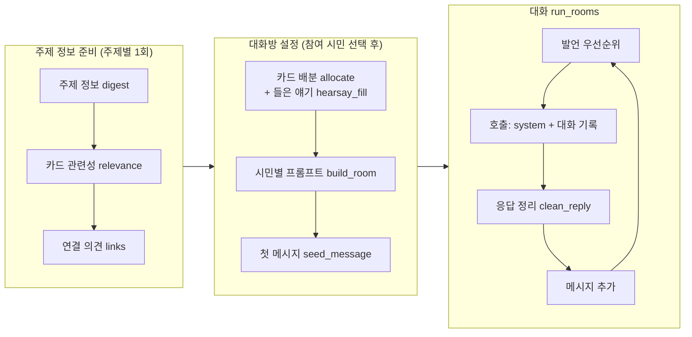

<div align="center">

# 사랑방 sarangbang

**한국어 단톡방 여론 시뮬레이션 엔진**

가상의 시민들이 정책, 제품, 동네 소식 같은 주제를 두고 대화하는 과정을 시뮬레이션합니다.<br>
대화 기록을 통해 시민별 관심사와 주요 쟁점, 의견 차이를 살펴볼 수 있습니다.

찬반 입장을 미리 정하지 않아도 시민의 배경과 관심사, 대화 맥락을 바탕으로 시뮬레이션할 수 있습니다.
필요하면 외부에서 계산한 찬반 성향을 시민별로 지정할 수도 있습니다.

LG AI Research의 [EXAONE](https://huggingface.co/LGAI-EXAONE)과 SK텔레콤의 [A.X(에이닷 엑스)](https://sktelecom.github.io/en/project/axllm/)를 사용하는 한국어 시뮬레이션을 위해 개발했습니다.
두 모델로 테스트하면서 발언 반복, 근거 없는 내용 생성, 응답 형식 오류를 줄이도록 프롬프트와 후처리를 조정했습니다.

춘풍팀이 함께 공개한 [Nemotron-Personas-Korea 증강판](https://huggingface.co/datasets/springwindteam/nemotron-personas-korea-augmented)을 시민 데이터로 사용할 수 있습니다. 한국인 100만 명의 가상 인물 정보가 담긴 데이터셋이며, CC BY 4.0 라이선스로 제공합니다.

[](LICENSE)


[빠른 시작](#빠른-시작) · [핵심 개념](#핵심-개념) · [프롬프트 설정](#프롬프트-설정-json) · [주제 설정](#주제-설정-topic) · [프롬프트 추가](#프롬프트-추가-promptplugin) · [English](#english)

</div>

---

## 목차

- [설계 배경](#설계-배경)
- [특징](#특징)
- [빠른 시작](#빠른-시작)
- [동작 방식](#동작-방식)
- [핵심 개념](#핵심-개념)
- [프롬프트 설정 JSON](#프롬프트-설정-json)
- [주제 설정 (Topic)](#주제-설정-topic)
- [프롬프트 추가 (PromptPlugin)](#프롬프트-추가-promptplugin)
- [페르소나 어댑터 만들기](#페르소나-어댑터-만들기)
- [주제 정보와 쟁점 카드 준비](#주제-정보와-쟁점-카드-준비)
- [결과 형식](#결과-형식)
- [모델 백엔드](#모델-백엔드)
- [EXAONE과 A.X에 맞춘 설정](#exaone과-ax에-맞춘-설정)
- [자주 묻는 질문](#자주-묻는-질문)
- [저장소 구조](#저장소-구조)
- [기여하기](#기여하기)
- [라이선스](#라이선스)

## 설계 배경

LLM 기반 사회 시뮬레이션은 주로 게시판이나 SNS 피드를 사용합니다. 에이전트가 글과 댓글을 작성하고 좋아요를 누르면, 다음 라운드에 갱신된 피드를 보여 주는 방식입니다.
한국어 정책 여론을 시뮬레이션하는 과정에서 다음과 같은 문제가 반복됐습니다.

1. 시민들이 기존 댓글의 표현을 따라 쓰면서 각자의 상황이나 입장이 대화에 잘 드러나지 않았습니다.
2. 이전 대화를 에이전트의 메모리에 계속 저장하면서 같은 내용이 반복되고 프롬프트가 길어졌습니다.

sarangbang에서는 서로 아는 사람들이 소규모 단톡방에서 대화하는 상황을 가정합니다. 대화 기록은 엔진에서 관리하고, 모델을 호출할 때마다 시민의 설정(`system`)과 현재 대화 기록(`user`)을 전달합니다.

## 특징

| | |
|---|---|
| **독립적인 모델 호출** | 호출마다 시민 정보와 프롬프트 설정을 `system`으로, 대화 기록을 `user`로 전달합니다. 대화 상태는 엔진이 관리합니다. |
| **비동기 실행** | 여러 방의 대화를 라운드 구분 없이 진행합니다. 방들은 레인(모델 엔드포인트)별 동시 호출 한도를 공유하며, 시민 한 명당 한 번에 하나의 호출만 진행합니다. |
| **발언 우선순위** | 주제와의 관련성, 최근 발언과 답장, 발언을 건너뛴 횟수, 대기 시간을 기준으로 다음 발언자를 선택합니다. 우선순위 계산에는 난수를 사용하지 않습니다. |
| **모델 분리** | 정적 점수가 높은 시민(앵커)은 대형 모델을, 나머지는 빠른 모델을 사용합니다. 앵커 레인 호출에 실패하면 기본 레인으로 재시도합니다. |
| **텍스트 응답** | 도구 호출 없이 발언 내용을 텍스트로 받습니다. `clean_reply`가 답장과 발언 생략 표시를 처리하고, 대화 기록을 그대로 복사한 부분과 추론 태그를 정리합니다. |
| **JSON 기반 프롬프트 설정** | 시민의 배경 정보, 관심사, 입장 등 프롬프트에 포함할 항목과 문구를 JSON 파일로 설정합니다. |
| **주제 설정** | 주제에 따라 달라지는 입장 안내, 프롬프트 항목명, 준비 단계의 지시문을 `Topic`에서 설정합니다. 정책용(`POLICY_KO`)과 범용(`GENERIC_KO`) 설정을 제공합니다. |
| **프롬프트 추가** | `PromptPlugin`으로 시스템 프롬프트와 응답 직전 안내에 내용을 추가할 수 있습니다. 대화 진행에 따라 달라지는 정보도 호출마다 전달할 수 있습니다. |
| **쟁점 카드** | 시민의 관점과 상황, 입장에 맞춰 쟁점 카드를 배정합니다. 카드를 받지 못한 시민에게는 '들은 얘기'로 참고할 카드를 하나 배정합니다. |
| **공개 페르소나 데이터셋** | `NemotronKoreaAdapter`로 Nemotron-Personas-Korea 증강판을 불러와 시민 데이터로 사용할 수 있습니다. 직접 만든 데이터도 어댑터로 연결할 수 있습니다. |
| **의존성과 서버 호환성** | 런타임 의존성은 `httpx` 하나입니다. OpenAI 호환 `/chat/completions` API를 제공하는 서버를 사용할 수 있습니다. |

## 빠른 시작

### 설치

```bash
git clone https://github.com/springwindteam/sarangbang.git
cd sarangbang
pip install -e .            # Python 3.10+
pip install -e ".[dev]"     # 테스트·린트(pytest, ruff)
```

### 모델 없이 실행하기

```bash
python examples/quickstart.py --fake --msgs 10
```

```text
#  1 07:00 마포: 다음 달부터 구립 도서관이 밤 10시까지 연다네요~^^ 퇴근하고 갈 수 있겠어요
#  2 08:36 서대문: 밤 10시까지면 퇴근하고 들를 수 있겠네요
#  3 10:12 은평: (#1에 답장) 골목이 어두워서 걱정이에요
…
{"sec": 0.0, "calls": 12, "rooms": [{"room_id": "r1", "messages": 10, "stop": "target"}]}
```

`--fake` 옵션을 사용하면 `FakeLane`이 미리 정해진 문장을 순서대로 반환합니다. 예제의 주제, 시민 정보, 쟁점 카드는 `examples/toy_policy.json`에 있습니다.
기본 실행에는 범용 설정(`GENERIC_KO`, `ko_generic`)을 사용합니다. 정책용 설정을 사용하려면 `--topic policy`를 추가합니다.

### 모델 연결하기

```bash
export SARANGBANG_BASE_URL=https://<openai-compatible-server>/v1
export SARANGBANG_API_KEY=...
export SARANGBANG_MODEL=...
python examples/quickstart.py --msgs 30
```

모델을 연결하면 대화를 시작하는 첫 메시지도 LLM이 생성합니다(`material.seed_message`).

## 동작 방식



발언자를 선택하고 메시지를 추가하는 과정은 다음과 같습니다.

1. 각 방에서 현재 응답을 생성하고 있지 않은 시민 중 **발언 우선순위**(`Room.urge`)가 가장 높은 시민을 선택합니다. 레인의 동시 호출 한도에 도달할 때까지 반복합니다.
2. 선택한 시민의 고정 `system` 프롬프트와 대화 기록을 담은 `user` 메시지를 모델에 전달합니다. 대화 기록에는 최근 메시지 30개, 첫 공유 메시지(#1), 해당 시민의 발언과 그에 대한 답장을 포함합니다.
3. `clean_reply`로 응답을 정리합니다. 발언을 건너뛰는 응답이면 해당 시민의 생략 횟수를 늘리고, 발언이 있으면 대화 기록에 추가합니다.
4. 응답을 생성하는 동안 새 메시지가 5개(`STALE_K`) 넘게 추가된 경우, 응답에 답장 표시가 없으면 해당 시민이 확인한 메시지에 대한 답장으로 자동 표시합니다.
5. 목표 메시지 수에 도달하거나 모든 시민이 연속 두 번씩 발언을 건너뛰면 해당 방의 대화를 종료합니다.

## 핵심 개념

### `Room`

```python
Room(room_id, personas, names, prompts, target, share,
     target_msgs=100, days=1, day_reset=False,
     scorer=None, anchor_frac=6/36, anchor_lane="anchor", base_lane="base",
     scene=KO, topic=GENERIC_KO, plugins=[])
```

| 인자 | 설명 |
|---|---|
| `personas` | 시민 레코드 목록입니다. 엔진은 레코드를 직접 해석하지 않고 `scorer`와 어댑터에 전달합니다. |
| `names` | 대화방에 표시할 이름입니다. 방 안에서 중복되지 않아야 합니다. |
| `prompts` | 시민별 `PersonPrompt`입니다. 일반적으로 `build_room`의 반환값을 사용합니다. |
| `target` | 시민이 주제와 얼마나 관련 있는지 판단하는 데 사용할 정보입니다. 예를 들어 정책 대상 연령을 지정할 수 있습니다. `scorer(persona, target)`와 어댑터에 그대로 전달합니다. |
| `share` | 첫 메시지입니다. `{"author": 방 안 번호, "text": …}` 형식으로 지정합니다. |
| `target_msgs`, `days` | 목표 메시지 수와 시뮬레이션 기간(일)입니다. 하루에 `target_msgs/days`개의 메시지를 07:00~23:00 사이에 균등하게 배치합니다. |
| `day_reset` | 날짜가 바뀌면 첫 공유 메시지(#1)와 당일 대화만 모델에 전달합니다. 대화가 길어져도 첫날의 주제가 계속 반복되지 않도록 하는 옵션입니다. |
| `scorer` | 발언 우선순위에 사용할 정적 점수를 계산하는 함수입니다. 점수 상위 `anchor_frac` 비율의 시민이 앵커 레인을 사용합니다. |
| `topic` | 주제 설정입니다. 반복 표현을 집계할 때 이 설정의 `common_words`에 등록된 단어를 제외합니다. |
| `plugins` | `PromptPlugin` 목록입니다. 호출할 때마다 `call_context`의 반환값을 대화 기록 뒤에 넣습니다. |

`Room.inject(text)`로 대화 중에 공지를 추가할 수 있습니다. 대화 기록에는 `#n 알림: …` 형식으로 표시됩니다.

### 발언 우선순위

```text
urge(i) = 정적 점수
        − 5 (최근 메시지 3개 중 본인 발언이 있음) 또는 − 2 (최근 메시지 8개 중 본인 발언이 있음)
        + 4 (마지막 호출 이후 본인 발언에 답장이 달림)
        − 발언 생략 횟수
        + (현재 메시지 수 − 마지막 호출 시점의 메시지 수) / 5
```

점수가 같으면 방 안에서 부여된 시민 번호가 작은 순서로 선택합니다.

### `Lane`과 `run_rooms`

```python
lanes = {"anchor": Lane.openai("anchor", BIG_URL, KEY, BIG_MODEL, slots=2),
         "base":   Lane.openai("base", FAST_URL, KEY, FAST_MODEL, slots=4)}
stats = await run_rooms(rooms, lanes, on_message=callback, should_cancel=lambda: False)
```

- `slots`는 모든 방이 공유하는 레인별 동시 호출 한도입니다. 대화 진행률이 낮은 방을 우선 처리합니다.
- `lanes`에 앵커 레인이 없으면 해당 방의 모든 시민이 기본 레인을 사용합니다.
- `on_message(room, msg)`는 새 메시지가 추가될 때마다 호출됩니다. 동기 함수와 비동기 함수를 모두 지원하며, 실시간 화면 표시나 메시지 저장에 사용할 수 있습니다.

## 프롬프트 설정 JSON

`build_room`은 시민별 정보와 대화 규칙을 조합해 프롬프트를 생성합니다. 아래는 프롬프트 구성 예시입니다.

```text
[system]
너는 '소소한 이야기방' 단톡방에 있는 '마포'이다. 이 방은 …
아래는 너에 대한 사실이다.

[나] …            ← 어댑터 fact_sections
[우리 아이] …
[내 성격] …
[학생으로서] …     ← 설정에서 활성화한 항목
[내 처지] …
[이 정책과 나] …   ← 이름은 주제 설정(topic.relation_label)
[살림·동네] …
[알고 있는 것] 사실 · 사실 · …
[들은 얘기] … 라는 얘기를 들은 적 있어 — 추측·의문형으로만
[관심사] …(내 생각: … / 궁금한 점 예: …)
(PromptPlugin.system_sections가 추가한 항목)

(장면 공통 규칙)
(설정 파일의 rule)

[user]
[소소한 이야기방 · 36명]
#1 마포: …
#2 은평: (#1에 답장) …
…
(PromptPlugin.call_context — 호출마다)
(입장 안내 · 가벼운 찬성 · (너: 신상 요약) · PromptPlugin.tail)   ← before_closing
(이미 여러 사람이 많이 한 말: …)
(마무리 지시)                                        ← closing
```

내장 설정 파일은 두 가지입니다.

| 이름 | 함께 사용할 주제 설정 | 설명 |
|---|---|---|
| `ko_generic` (기본값) | `GENERIC_KO` | `ko_s12`의 구성을 유지하면서 정책에 한정된 표현을 다른 주제에도 쓸 수 있도록 바꾼 설정입니다. 아직 비교 테스트를 거치지 않았습니다. |
| `ko_s12` | `POLICY_KO` | 한국어 교육정책 시뮬레이션에서 비교 테스트로 선정한 설정입니다. |

설정 파일에서 사용할 수 있는 항목은 다음과 같습니다.

| 키 | 설명 |
|---|---|
| `known_label`, `fact_fmt`, `known_join`, `show_condition`, `show_status` | [알고 있는 것] — 주제에 관한 사실과 적용 조건, 현재 상태 표시 |
| `known_trim` | 주제와 직접 관련이 없는 시민에게는 사실 목록의 처음 N개만 제공 |
| `unknown_label` | 문서에서 답을 찾을 수 없는 질문 목록(기본값: 비활성화) |
| `hearsay_label`, `hearsay_fmt`, `hearsay_suffix` | [들은 얘기] — 카드의 전제에 출처를 덧붙이고 추측으로 표현하도록 안내 |
| `interest_label`, `interest_fmt`, `interest_fmt_link`, `interest_suffix` | [관심사] — 카드 관심사 + 연결 의견 + 궁금한 점 |
| `teen_rule`, `student_reminder` | 학생인 시민이 자신의 입장에 맞게 발언하도록 하는 규칙과 응답 직전 안내 |
| `life_stage`, `life_stage_suffix` · `relation` · `living` | [내 처지] · 주제와의 관계 · [살림·동네] 항목의 포함 여부 |
| `life_stage_label`, `relation_label`, `living_label` | 위 세 항목의 이름. `relation_label`이 없으면 주제 설정의 `relation_label`을 사용 |
| `self_reminder` | 응답 직전에 표시할 시민 정보 요약 `(너: 신상 요약)` |
| `align_stance` | 카드 수와 관점 조건을 유지하면서 시민의 입장에 맞게 카드를 재배정 |
| `light_support` | 찬성 입장인 시민 일부에게 '가벼운 찬성' 안내 추가 |
| `rule`, `closing`, `closing_nocard` | 공통 규칙과 응답 직전 지시문. 카드가 없는 시민에게는 별도 지시문 지정 가능 |

직접 작성한 설정을 사용하려면 `load_spec`에 JSON 파일 경로를 전달합니다.

```python
spec = load_spec("my_spec.json")      # 또는 내장 이름 load_spec("ko_generic"), load_spec("ko_s12")
```

방 이름, 설명, 공통 규칙, 모델에 전달할 대화 기록의 범위는 `Scene`에서 설정합니다.

```python
from dataclasses import replace
from sarangbang import KO
scene = replace(KO, room_name="우리 아파트 단톡방", room_desc="같은 단지에 사는 이웃들이 모인 방이다")
```

> 정책용 프롬프트(`ko_s12`)는 동일한 정책과 시민 구성에서 여러 설정을 비교해 선정했습니다. 대화 주제의 다양성, 근거 없는 내용이나 다른 시민의 발언을 반복하는 정도, 설정된 입장과 실제 발언의 일치 여부를 평가했습니다. 문구를 수정할 때도 같은 기준으로 결과를 비교하는 것을 권장합니다.

### 찬반 성향 지정하기

찬반 성향은 선택 사항입니다. 별도로 지정하지 않으면 모델이 페르소나의 배경과 관심사, 제공된 주제 정보, 대화 흐름을 바탕으로 발언을 생성합니다. 시민마다 찬성이나 반대 입장을 미리 정해 둘 필요는 없습니다.

외부 모델이나 규칙으로 계산한 값이 있다면 `build_room`의 `leans`에 전달할 수 있습니다. 각 시민에 대해 `-1`~`1` 범위의 값을 받으며, 음수는 반대, 양수는 찬성을 뜻합니다. 절댓값이 클수록 강한 입장으로 안내합니다. 일부 시민에게만 값을 지정하고 나머지는 `None`으로 둘 수도 있습니다.

```python
# 찬반 입장을 지정하지 않고 페르소나를 바탕으로 대화 생성
leans = [None] * len(personas)

# 외부에서 계산한 성향을 지정하는 경우 (시민 3명 예시)
leans = [0.7, -0.4, None]
```

`leans`는 찬성할 확률 자체가 아니라 프롬프트에 반영할 입장의 방향과 강도입니다. 외부에서 찬성 확률을 계산했다면 이를 성향 점수로 변환해 전달할 수 있습니다. 예를 들어 `2 * p - 1`로 변환하면 찬성 확률 `p=0.8`은 성향 점수 `0.6`이 됩니다. 이 값은 발언을 유도하는 설정이며, 생성된 발언의 찬반 비율을 고정하지는 않습니다.

입장에 따른 카드 재배정도 사용하지 않으려면 프롬프트 설정에서 `align_stance=False`로 지정합니다. 이 경우 처음 배정한 카드를 그대로 사용합니다.

## 주제 설정 (Topic)

`Topic`에서 주제별 문구를 설정합니다. 주제를 바꿔도 대화 진행, 카드 배정, 대화 기록 처리에는 같은 로직을 사용합니다.

| 필드 | 설명 | `POLICY_KO` 예시 | `GENERIC_KO` 예시 |
|---|---|---|---|
| `noun`, `label` | 주제 이름(플러그인 등에서 참조)과 사실 정보 앞에 표시할 제목 | `정책`, `[정책]` | `소식`, `[소식]` |
| `stance_heads` | 찬반 입장과 그 강도(강·중·약)에 따른 안내 문장 | "당신은 이런 정책에 대체로 찬성해 온 사람이다." | "당신은 이 일을 대체로 좋게 보는 사람이다." |
| `strong`, `mid`, `weak` | 입장 강도를 나누는 기준값(기본 0.6 / 0.3 / 0.05) | | |
| `relation_label` | 시민과 주제의 관계를 설명하는 항목의 제목 | `[이 정책과 나]` | `[이 일과 나]` |
| `relevance_system`, `link_system`, `seed_system` | 카드의 관련성 평가, 주제와 연결된 의견 작성, 첫 메시지 생성에 사용할 프롬프트 | 교육정책 테스트에 사용한 문구 | 범용 문구 |
| `common_words` | 주제상 자주 등장하므로 반복 표현 집계에서 제외할 단어 | 정책, 제도, 확대 … | 소식, 이번, 얘기 |

새 주제를 추가하려면 기존 설정을 복사하고 필요한 필드를 수정합니다.

```python
from dataclasses import replace
from sarangbang import GENERIC_KO

CAFE = replace(GENERIC_KO, noun="가격 인상", label="[가게 소식]", relation_label="[이 가게와 나]",
               common_words=GENERIC_KO.common_words | {"카페", "커피", "가격"})

prompts = build_room(..., spec=load_spec("ko_generic"), topic=CAFE)
room = Room(..., topic=CAFE)
```

각 단계에서 같은 문구를 사용하도록 `build_room`, `Room`, `material.relevance`, `material.links`, `material.seed_message`에 동일한 주제 설정을 전달합니다.
`TopicAdapter` 프로토콜(`head`, `stance_line` 등)을 직접 구현해서 사용할 수도 있습니다.

## 프롬프트 추가 (PromptPlugin)

`PromptPlugin`은 설정 파일 외에 별도 정보를 프롬프트에 추가할 때 사용합니다. 아래 메서드 중 필요한 것만 구현하면 됩니다.

| 메서드 | 실행 시점 | 추가되는 위치 |
|---|---|---|
| `system_sections(p, i, ctx) -> list[str]` | 대화방 설정 시 1회(`build_room`) | 시스템 프롬프트의 설정 항목 뒤, 공통 규칙 앞 |
| `tail(p, i, ctx) -> str` | 대화방 설정 시 1회(`build_room`) | 응답 직전 안내(`before_closing`)의 끝 |
| `call_context(room, i) -> str` | 모델을 호출할 때마다(`Room.user_message`) | 대화 기록과 응답 직전 안내 사이 |

`ctx`에서 `names`, `target`, `digest`, `topic`, `given`을 참조할 수 있습니다. 대화 진행에 따라 달라지는 정보는 `call_context`로 전달합니다. 이 내용은 해당 호출에만 포함되며 다음 호출에 자동으로 유지되지 않습니다.

```python
from sarangbang import StaticSections

class Weather:
    def call_context(self, room, i):
        day = room.vt(room.n_say())["day"]
        return "(오늘은 비가 온다)" if day == 2 else ""

class Dialect:
    def system_sections(self, p, i, ctx):
        return ["[말투] 부산 사투리를 쓴다"] if p.get("city") == "부산" else []

plugins = [StaticSections(["[공통] 서로 존댓말을 쓴다"]), Dialect()]
prompts = build_room(..., plugins=plugins)
room = Room(..., plugins=[Weather()])
```

내장 플러그인 `StaticSections(sections, who=None)`은 모든 시민의 프롬프트에 동일한 항목을 추가합니다. `who`를 지정하면 `who(p, i)`가 참인 시민에게만 추가합니다.

## 페르소나 어댑터 만들기

시민 데이터는 원하는 형식으로 구성할 수 있습니다. 해당 데이터에서 필요한 정보를 읽도록 `PersonaAdapter`를 구현하면 됩니다.

```python
class MyAdapter:
    def fact_sections(self, p, target):    return [f"[나] {p['age']}세 {p['job']}, {p['city']}에 산다"]
    def student_level(self, p):            return p.get("grade", "")        # 학생이면 '고2', 아니면 ''
    def stage_line(self, p):               return p.get("stage", "")        # [내 처지]
    def relation_line(self, p, target):    return "자녀가 이번 일의 대상 학년이다" if p.get("kid_in_target") else ""
    def short_self(self, p):               return f"{p['age']}세 · {p['job']}"
    def living_line(self, p):              return ""
    def affected(self, p, target):         return bool(p.get("kid_in_target"))
    def light_support_ok(self, p):         return True
    def card_fits(self, card, p):          return all(r in p.get("tags", []) for r in card.get("require", []))
    def own_perspectives(self, p):         return ["학부모"] if p.get("has_kids") else []
    def static_score(self, p, target):     return 3 if p.get("kid_in_target") else 0
    def seed_profile(self, p, target):     return self.fact_sections(p, target)
    def display_names(self, personas):     return [p["nickname"] for p in personas]
```

시민 정보가 문장 형태로 정리된 dict라면 내장 `DictAdapter`를 사용할 수 있습니다. 데이터 형식은 `examples/toy_policy.json`을 참고하세요.

### 공개 페르소나 데이터셋: Nemotron-Personas-Korea 증강판

[Nemotron-Personas-Korea 증강판](https://huggingface.co/datasets/springwindteam/nemotron-personas-korea-augmented)은 sarangbang을 개발한 춘풍팀이 NVIDIA의 [Nemotron-Personas-Korea](https://huggingface.co/datasets/nvidia/Nemotron-Personas-Korea)에 정책·여론 시뮬레이션용 정보를 추가한 데이터셋입니다. 한국인 100만 명의 가상 인물 정보를 담고 있으며, CC BY 4.0 라이선스로 공개했습니다.

소득 순위와 정치 성향 등 여론 분석에 필요한 정보, 참여자를 조건별로 선택할 때 쓸 수 있는 자녀 유무와 교육 분야 종사 여부를 추가했습니다. 다문화 가구 데이터를 보강하고, 각 인물을 1인칭으로 소개하는 요약문도 포함했습니다.

`NemotronKoreaAdapter`를 사용하면 데이터셋의 각 행을 별도로 변환하지 않고 시민 데이터로 전달할 수 있습니다. 데이터셋을 사용할 때는 소개 페이지의 인용 안내에 따라 원본과 증강판을 함께 표기해 주세요.

```python
from sarangbang.adapters import NemotronKoreaAdapter

ad = NemotronKoreaAdapter()                 # include_story=True면 story_summary를 [내 이야기]로 추가
target = {"relations": [                    # 데이터 열 조건 → 주제와의 관계 문장·정적 점수
    {"if": {"housing_type": ["다세대주택", "연립주택", "단독주택"]}, "text": "주차 공간이 부족한 집에 산다", "score": 2},
    {"if": {"has_children": True}, "text": "아이들을 태우고 다닐 일이 많다", "score": 1},
]}
prompts = build_room(rows, ad.display_names(rows), adapter=ad, target=target, ...)
```

| 프롬프트 항목 | 데이터셋 열 |
|---|---|
| [나] | `age`, `sex`, `district`, `occupation`(무직이면 `activity_status`), `education_level`, `mc_household` |
| [우리 아이] | `has_children` (자녀 나이 정보는 없음) |
| [내 처지] | `marital_status`, `family_type` |
| [살림·동네] | `housing_type`, `income_rank` |
| 주제와의 관계 · 정적 점수 · 직접 영향 여부 | `target["relations"]` 규칙에 맞는 열 값 |
| 카드 조건 태그 | `has_children`→`parent`·`any_kid`, `is_education_worker`→`edu_worker`, `activity_status=재학`→`student`, `mc_household`→`multicultural` |
| 표시 이름 | `district`의 마지막 낱말(예: `인천-연수구` → `연수`) |

데이터셋에 성격 점수와 자녀 나이 정보가 없어 프롬프트에도 `[내 성격]`과 자녀 학년을 포함하지 않습니다. 모든 인물이 만 19세 이상이며, 어댑터는 `activity_status=재학`인 인물을 대학생으로 처리합니다.

[`examples/nemotron_korea.py`](examples/nemotron_korea.py)에서 실행 예시를 확인할 수 있습니다. 이 예제는 Hugging Face 데이터셋 뷰어 API로 필요한 행만 불러옵니다.

## 주제 정보와 쟁점 카드 준비

### 주제 정보(digest)

시민에게 제공할 주제 요약과 사실 정보입니다. 분야에 맞게 직접 작성하거나 LLM으로 추출해 준비합니다.

```json
{"summary": "이 소식이 무엇인지 두 문장",
 "facts": [{"statement": "2025년부터 초1~2 희망 학생에게 매일 2시간 무료 프로그램", "condition": "희망자", "status": "확정·시행"}],
 "not_stated": [{"question": "총예산은 얼마인가?"}]}
```

### 쟁점 카드

쟁점 카드는 주제와 관련된 쟁점을 시민의 관심사로 정리한 데이터입니다.

```json
{"id": "c1", "name": "야간 안전", "interest": "밤늦게 오가는 길의 안전", "ask_form": "가로등이나 순찰은 늘리나?",
 "perspective": "학부모", "require": ["any_young_kid"], "arg_types": ["안전"], "freq": 5,
 "stance_lean": {"lean": "조건부"},
 "premises": [{"premise": "도서관 앞 골목은 밤에 어둡다", "scope": "범위 미상", "time": "원글 날짜 미상"}],
 "sources": [{"kind": "시민 의견", "platform": "cafe"}]}
```

주제 정보와 카드를 준비한 뒤, 아래 순서로 관련성을 평가하고 시민에게 카드를 배정합니다.

```python
from sarangbang import GENERIC_KO, JsonLLM, material as M, kept, allocate, hearsay_fill

topic = GENERIC_KO
llm = JsonLLM.openai(BASE_URL, KEY, MODEL)
head = M.head(title, digest, topic)
rel_of, _ = M.relevance(llm, head, candidate_cards, topic=topic)   # direct | related | unrelated
links, _ = M.links(llm, head, kept(rel_of, cards), topic=topic)    # 카드마다 1인칭 연결 의견 한 줄
given = allocate(kept(rel_of, cards), personas, 2, rel_of, adapter)
given = hearsay_fill(given, kept(rel_of, cards), rel_of)    # 카드가 없는 시민에게 '들은 얘기'로 참고할 카드 배정
given = [[{**x, "link": links.get(x["card"], "")} for x in v] for v in given]
```

`relevance`와 `links`는 시민 구성에 의존하지 않으므로 주제와 후보 카드가 준비되면 미리 실행할 수 있습니다.

## 결과 형식

생성된 메시지는 `room.msgs`에 다음 형식으로 저장됩니다.

```json
{"id": 12, "author": 3, "text": "…", "reply_to": 9, "auto_reply": false,
 "vt": {"day": 1, "time": "14:24"}, "model": "big-model", "seen_upto": 10, "stale": 1, "fixes": ["답장 표시 변형"]}
```

`room.calls`에는 각 호출의 레인, 응답 시간, 성공 여부, 모델 원본 응답, 응답 정리 내역이 저장됩니다. `run_rooms`는 실행 시간과 호출 수, 방별 메시지 수 및 종료 사유를 반환합니다.
반환값의 구조는 `{"sec", "calls", "rooms": [{"room_id", "messages", "stop": "target"|"quiet"}]}`입니다.

## 모델 백엔드

- `Lane`과 `JsonLLM`은 OpenAI 호환 `/chat/completions` API를 호출합니다. vLLM, SGLang, 상용 게이트웨이 등을 연결할 수 있습니다.
- 발언 생성에 사용하는 기본 샘플링 설정은 `temperature 0.7 · presence_penalty 0.4 · frequency_penalty 0.3 · max_tokens 400`입니다.
  `chat_template_kwargs.enable_thinking=false`로 추론 모드를 비활성화합니다. 서버가 이 옵션을 지원하지 않으면 `Lane(sampling=…)`으로 설정을 변경할 수 있습니다.
- 일시적인 오류(429·5xx)가 발생하면 4·8·12…초 간격으로 최대 6회 재시도합니다. 호출이 최종적으로 실패하면 해당 시민의 차례를 건너뛰고 대화를 계속합니다.
- 기본값은 EXAONE과 A.X를 사용한 테스트를 바탕으로 정했습니다. 앵커 레인에는 대형 모델을, 기본 레인에는 빠른 모델을 사용하는 구성입니다.

## EXAONE과 A.X에 맞춘 설정

EXAONE과 A.X로 테스트하면서 영어 지시문이 섞이면 대화 품질이 떨어지고, 기존 발언을 복사하거나 시민 정보에 없는 가족을 만들어 내는 문제를 확인했습니다. 기본 프롬프트와 후처리 규칙은 이런 문제를 줄이도록 조정했습니다.

### 프롬프트

시민의 발언을 생성하는 프롬프트는 한국어로 작성했습니다. 대화 기록도 영어 설명이나 JSON 피드 없이 단톡방에 표시되는 형태의 텍스트로 전달합니다.

- **발언 반복과 근거 없는 설정 추가 방지:** EXAONE에서 관찰한 문제를 줄이기 위해 다른 사람의 말을 그대로 따라 쓰지 않고, 시민 정보에 없는 가족·직업·경험을 만들지 않도록 안내합니다.
- **사실과 전해 들은 이야기 구분:** `[들은 얘기]`는 확인된 사실과 구분해 추측이나 질문으로만 표현하도록 안내합니다.
- **입장 안내:** 찬반 성향을 지정한 경우, 해당 입장을 설명하는 문장의 앞부분을 `user` 메시지의 마지막 지시문 앞에 넣습니다. 성향을 지정하지 않으면 이 안내는 추가하지 않습니다.
- **첫 메시지 생성:** A.X가 시민 정보에 없는 조카를 언급했던 사례를 반영해, 첫 메시지 프롬프트에도 조카·형제·손주를 임의로 만들지 않도록 명시했습니다.
- **반복 주제 감지:** '이미 많이 나온 말'을 집계할 때 한국어 조사를 제거합니다. 같은 단어에 서로 다른 조사가 붙어도 함께 집계하기 위한 처리입니다.

관련 설정과 구현은 [`scene.py`](src/sarangbang/scene.py), [`ko_s12.json`](src/sarangbang/specs/ko_s12.json), [`log.py`](src/sarangbang/log.py), [`topic.py`](src/sarangbang/topic.py)에 있습니다.

### 모델 호출

`chat_template_kwargs.enable_thinking=false`로 EXAONE·A.X의 채팅 템플릿에서 추론 모드를 끄도록 요청합니다. 반복을 줄이기 위해 `temperature=0.7`, `presence_penalty=0.4`, `frequency_penalty=0.3`을 기본값으로 사용합니다.

EXAONE이 테스트에서 도구 호출을 거의 사용하지 않았던 점을 반영해, 시민의 발언은 도구 호출 없이 텍스트로 받습니다. 모델에는 보낼 메시지만 작성하도록 요청합니다.

### 응답 후처리

[`reply.clean_reply`](src/sarangbang/reply.py)는 모델이 요청한 형식을 따르지 않았을 때 다음 규칙으로 응답을 정리합니다.

| 응답 유형 | 처리 방식 |
|---|---|
| `<think>…</think>`가 포함된 응답 | 태그와 그 안의 추론 내용을 제거합니다. |
| `#12 마포: …`처럼 대화 기록을 복사한 응답 | 다른 시민의 기록은 제거하고, 본인의 기록은 번호와 이름을 제외한 발언만 남깁니다. |
| `(넘어감)`, `[넘어감]`, `넘어감.` 또는 짧은 “덧붙일 말이 없어요” 등의 응답 | 발언을 건너뛴 것으로 처리합니다. 넘어감 표시와 실제 발언이 함께 있으면 발언을 남깁니다. |
| `[#8에 답장]`, `#43 마산회원에 답장:`, `(#1 경북 남구)` 등 | 답장 대상 번호와 발언 내용을 분리해 같은 형식으로 처리합니다. |
| `[이름]`으로 구분한 여러 사람의 발언 또는 여러 개의 답장 | 본인 발언을 우선 선택하고, 답장이 여러 개면 첫 번째만 남깁니다. |
| 다른 시민의 이름으로 작성하거나 이름만 보낸 응답 | 발언을 건너뛴 것으로 처리합니다. |

다른 OpenAI 호환 모델도 연결할 수 있습니다. 다만 기본 프롬프트와 후처리 규칙은 두 모델의 한국어 응답을 기준으로 조정했으므로, 모델을 바꾸면 생성된 대화를 확인하며 설정을 맞추는 것이 좋습니다.

## 자주 묻는 질문

**CAMEL이나 OASIS 같은 에이전트 프레임워크를 사용하지 않는 이유는 무엇인가요?**
각 모델 호출에 전달할 정보를 직접 관리하기 위해서입니다. 이전 대화가 메모리에 계속 쌓이면서 발생하는 반복을 줄이고, 프롬프트의 내용을 쉽게 확인할 수 있습니다. 대화 상태는 엔진의 `Room.msgs`에서 관리합니다.

**같은 설정으로 실행하면 결과도 같나요?**
엔진의 발언 우선순위 계산, 카드 배정, 대화방 진행 로직에는 난수를 사용하지 않습니다. 다만 모델의 샘플링(`temperature`)과 네트워크 상황에 따른 응답 완료 순서 때문에 실행 결과는 달라질 수 있습니다.

**다른 언어도 지원하나요?**
엔진 자체는 특정 언어에 의존하지 않습니다. 다만 기본 설정은 한국어를 기준으로 작성되어 있습니다. 다른 언어를 사용하려면 `Scene`의 문구, 프롬프트 설정 JSON, `clean_reply`의 한국어 처리 패턴, 반복 표현 감지에 사용하는 조사와 일반 단어 목록을 변경해야 합니다.

**한 방에 몇 명을 넣는 것이 적당한가요?**
방 하나당 30~40명을 권장합니다. 인원이 더 많으면 여러 방으로 나눠 `run_rooms`에 함께 전달할 수 있습니다. 여러 방은 레인별 동시 호출 한도를 공유합니다.

## 저장소 구조

```text
src/sarangbang/
├── engine.py      Room · run_rooms · parse_text
├── llm.py         Lane · JsonLLM · FakeLane
├── spec.py        load_spec · build_room · PersonPrompt · align_given
├── scene.py       Scene(장면 문구) · KO
├── log.py         render_log · saturated_terms
├── reply.py       clean_reply
├── stance.py      stance_line
├── topic.py       Topic · TopicAdapter · POLICY_KO · GENERIC_KO
├── plugins.py     PromptPlugin · StaticSections
├── cards.py       allocate · hearsay_fill · kept
├── material.py    relevance · links · seed_message · head
├── persona.py     PersonaAdapter · DictAdapter
├── adapters/      NemotronKoreaAdapter (Nemotron-Personas-Korea 증강판)
└── specs/         ko_generic.json · ko_s12.json
examples/          quickstart.py · toy_policy.json · nemotron_korea.py
tests/             pytest
```

## 기여하기

기여 방법은 [CONTRIBUTING.md](CONTRIBUTING.md)를 참고하세요. 프롬프트 문구를 변경하는 경우에는 실험 조건, 평가 결과, 대화 샘플을 함께 첨부해 주세요.

## 라이선스

[Apache License 2.0](LICENSE)을 따릅니다. 관련 고지 사항은 [NOTICE](NOTICE)에서 확인할 수 있습니다.

---

## English

**sarangbang** simulates public opinion as conversation. LLM personas chat in small Korean group-chat rooms
(*danthokbang*) about a topic — a policy, a product, a neighborhood issue — and the transcript is the output.

- **Stateless calls.** Every call is `system` (persona facts + spec sections) + `user` (the chat transcript rendered as it would
  appear on screen). No agent memory, no rounds.
- **Async rooms.** Many rooms share per-lane concurrency limits. One in-flight call per persona; late replies get an automatic reply-to.
- **Deterministic speaker order.** A data-driven static score plus recency, replies, passes and waiting time. No randomness in the engine.
- **Two lanes.** The top-scored personas (anchors) use a stronger model; the rest use a fast one; failed anchor calls fall back.
- **Spec JSON.** Prompt sections and wording live in one JSON file. The bundled `ko_s12` spec was selected by comparative tests on
  Korean education-policy simulations; `ko_generic` is the topic-neutral default.
- **Topic adapter.** Stance sentences, the relation-section label and the preparation prompts depend on the topic and live in `Topic`
  (`POLICY_KO`, `GENERIC_KO`, or your own).
- **Prompt plugins.** `PromptPlugin` adds system sections, a closing tail, or per-call context without editing the spec.
- **Bring your own personas.** Records are opaque to the engine. Implement `PersonaAdapter` for your schema, or use the bundled
  `NemotronKoreaAdapter` for [Nemotron-Personas-Korea — Augmented](https://huggingface.co/datasets/springwindteam/nemotron-personas-korea-augmented),
  1M synthetic Korean personas (CC BY 4.0) released by the same team (Team Chunpung).
- **Any OpenAI-compatible backend.** Runtime dependency: `httpx`.

```bash
pip install -e .
python examples/quickstart.py --fake
```

Licensed under Apache-2.0.
